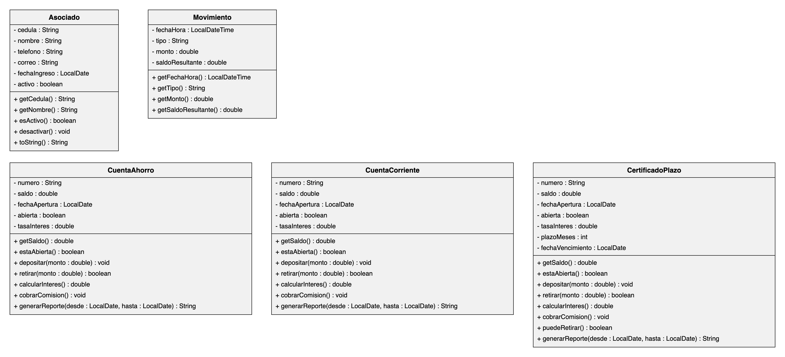

# Modelo de dominio del sistema CoopeTica R.L.

**Curso:** BIS04 Programación II  
**Actividad:** Tarea 1

## Integrantes

- Santiago Gutiérrez Monge ([@SantiagoGM0186](https://github.com/SantiagoGM0186))
- Sofía Cordero ([@scordero17](https://github.com/scordero17))

## Descripción del dominio

CoopeTica R.L. es una cooperativa de ahorro y crédito que necesita organizar mejor la información que administra. Actualmente, los datos se llevan en hojas de cálculo dispersas, lo que dificulta mantener la información ordenada y consultar los registros de forma consistente. El sistema propuesto permitirá organizar a los asociados, las cuentas que poseen —de ahorro, corriente y certificados a plazo— y los movimientos que se realizan en esas cuentas. De esta manera, cada elemento tendrá sus propios datos y operaciones principales.

## Diagrama de clases del dominio

El diagrama se presenta sin relaciones entre las clases porque las relaciones no se evalúan en esta tarea.

## Justificación del modelo

### a) ¿Cómo identificamos las clases?

Para identificar los elementos del modelo, revisamos la descripción del problema y distinguimos los sustantivos y los verbos. Los sustantivos fueron candidatos a clases o atributos, mientras que los verbos fueron candidatos a métodos. Consideramos una clase cuando el elemento tiene comportamiento propio, puede tener múltiples instancias con datos diferentes y agrupa varios datos; si únicamente almacena un valor simple, lo modelamos como atributo.

### b) ¿Por qué escogimos cada clase?

- **Asociado:** representa a cada persona afiliada a la cooperativa. Agrupa información como cédula, nombre, teléfono, correo, fecha de ingreso y estado, y tiene el comportamiento `desactivar()` para indicar que deja de estar activo sin eliminar su registro.
- **CuentaAhorro:** representa una cuenta de ahorro y reúne sus datos, como número, saldo, fecha de apertura, estado y tasa de interés. Se modela como clase aparte porque, según el enunciado, calcula sus intereses con una tasa distinta y cobra comisiones diferentes a las de los otros productos.
- **CuentaCorriente:** representa una cuenta corriente. Aunque comparte algunos datos y operaciones con la cuenta de ahorro, se modela como una clase distinta porque, según el enunciado, calcula sus intereses con una tasa distinta y cobra comisiones diferentes.
- **CertificadoPlazo:** representa una inversión con plazo definido. Además de los datos comunes de una cuenta, contiene `plazoMeses` y `fechaVencimiento`, y contempla la regla de que no se puede retirar el dinero antes del vencimiento.
- **Movimiento:** representa cada operación realizada sobre una cuenta. Registra la fecha y hora, el tipo de operación, el monto y el saldo resultante, de modo que quede constancia de cada depósito, retiro, aplicación de intereses y cobro de comisión.

También se tomaron las siguientes decisiones de diseño:

- **`activo` como boolean:** permite representar si un asociado está activo o no. Así se puede desactivar a una persona sin borrar su información histórica.
- **`retirar()` con retorno boolean:** devuelve `true` cuando el retiro se completa y `false` cuando no se puede realizar, por ejemplo, por falta de saldo. Así se cumple lo que pide el enunciado: registrar retiros validando que haya saldo suficiente.
- **Cédula sin método `set`:** se considera un dato identificador que no debería cambiarse libremente después de crear el asociado. Por eso se permite consultarla, pero no modificarla mediante un método público `setCedula()`.
- **`puedeRetirar()` en CertificadoPlazo:** revisa si ya pasó la fecha de vencimiento, porque el certificado no permite retiros antes de esa fecha.
- **`generarReporte(desde, hasta)`:** responde a la necesidad de generar un reporte de movimientos por cuenta entre dos fechas.
- **`toString()` en Asociado:** permite consultar el detalle de cualquier asociado, como pide el enunciado.
- **Atributos privados y métodos públicos:** los atributos se marcan con `-` para proteger los datos internos de cada objeto. Los métodos se marcan con `+` para exponer las operaciones que otras partes del sistema pueden utilizar de manera controlada.

### c) ¿Qué descartamos y por qué?

- **Cooperativa:** no se incluyó como clase porque, en el alcance de esta tarea, representa el sistema o contexto completo y no una entidad de la que se necesite crear múltiples instancias con datos y comportamiento propios.
- **Interés y comisión:** no se modelaron como clases independientes porque son valores que se obtienen mediante operaciones. Por eso se representan mediante métodos como `calcularInteres()` y `cobrarComision()`.
- **Depósito, retiro, aplicación de intereses y cobro de comisión:** no se modelaron como clases separadas. Se pueden registrar como valores del atributo `tipo` de la clase `Movimiento`, mientras que las operaciones correspondientes se representan mediante métodos de las cuentas.
- **Cédula, nombre, teléfono, correo, saldo, tasa de interés y fechas:** se definieron como atributos porque cada uno almacena un dato específico de un asociado, una cuenta o un movimiento, y no necesita ser una clase independiente en este modelo.

## Bitácora de uso de inteligencia artificial

Se utilizó **Claude (Anthropic)** como guía durante el modelado. Revisaba párrafo por párrafo las clases, atributos y métodos que proponíamos y señalaba errores de notación UML, visibilidad y tipos. También se usó para repasar los conceptos de clases, atributos, métodos y encapsulamiento, y para orientar la organización y redacción de este README. Las decisiones finales del modelo y la revisión del contenido corresponden a los integrantes del equipo.
